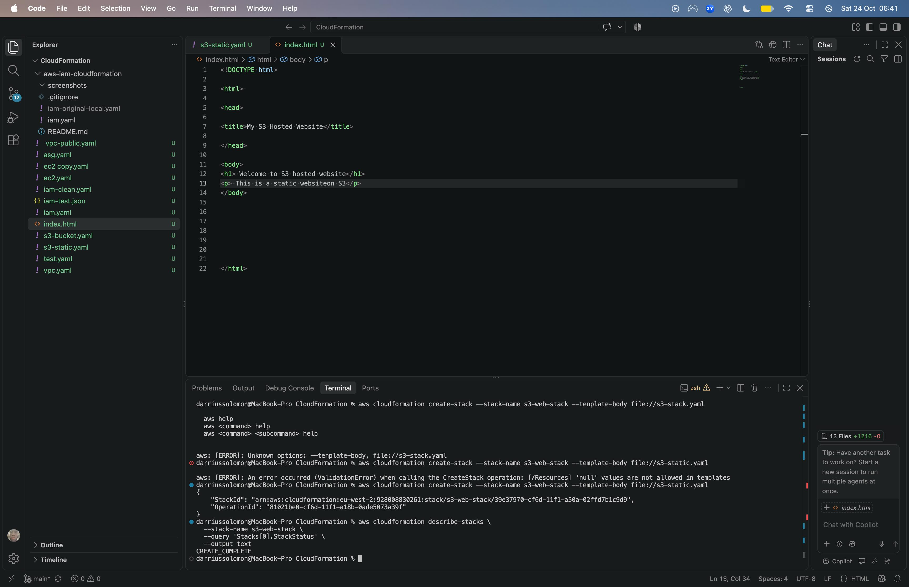
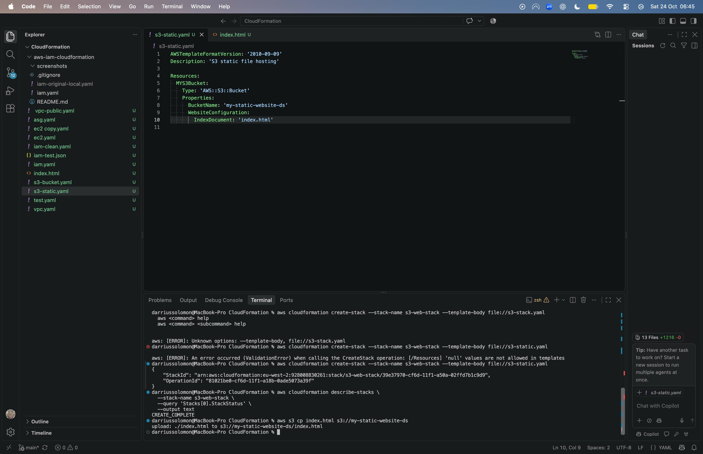
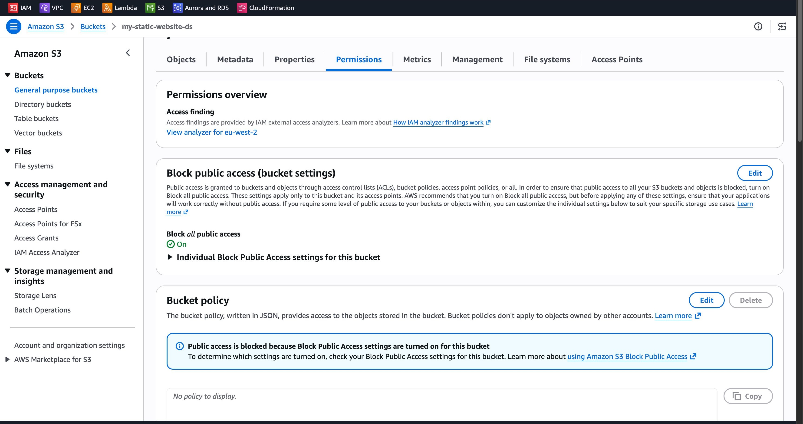
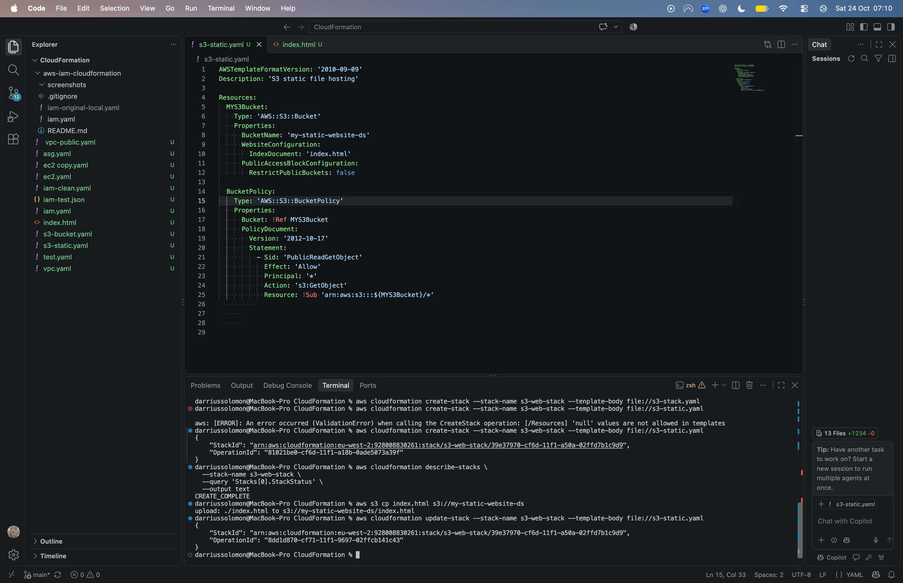
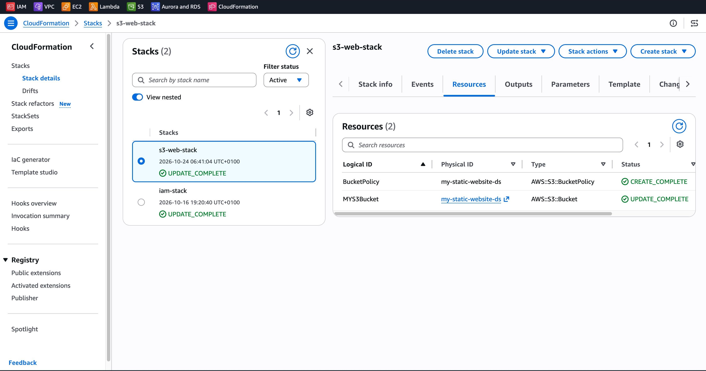
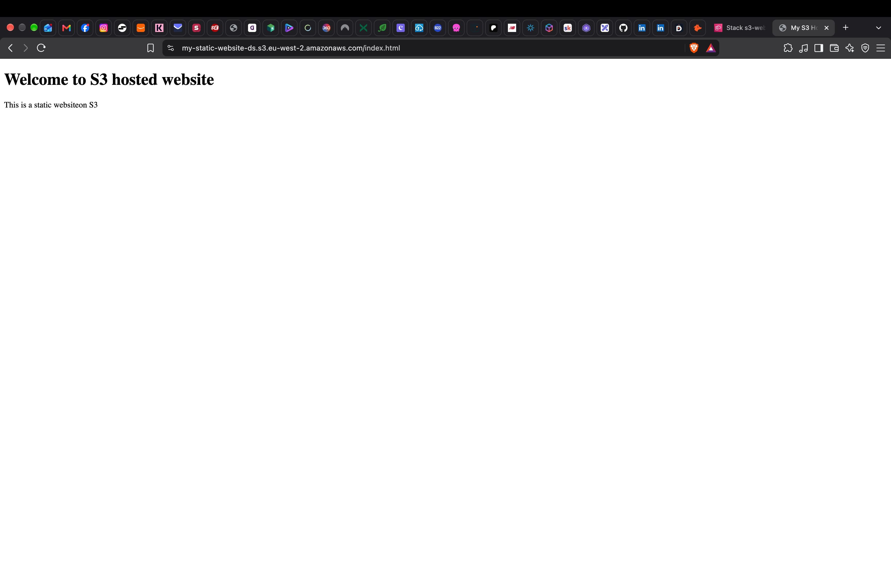
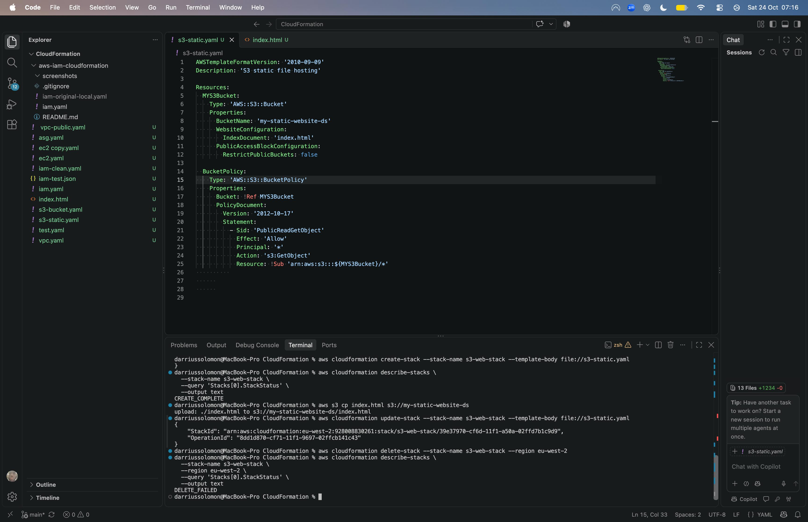

## AWS S3 Static Website Hosting Using CloudFormation

## Project Overview

In this project, I deployed a static website using Amazon S3, AWS CloudFormation, and the AWS Command Line Interface (CLI).

The objective was to gain practical experience with Infrastructure as Code (IaC), automated resource provisioning, S3 static website hosting, and AWS access permissions.

I created a CloudFormation YAML template to provision an S3 bucket and configured it to host a simple HTML website.

During deployment, I encountered an AccessDenied error when attempting to access the website. I investigated the S3 bucket’s public access settings and updated the CloudFormation template to configure the required permissions.

After resolving the access issue, I successfully accessed the website through the browser and verified that the HTML content was being served from Amazon S3.

Once testing was complete, I removed the uploaded website files and deleted the CloudFormation stack to clean up the AWS resources.

## AWS Services Used

* Amazon S3: Used to store and host the static HTML website.
* AWS CloudFormation: Used to provision and manage the S3 bucket and its configuration through a YAML template.
* AWS CLI: Used to deploy and update the CloudFormation stack, upload the HTML file, verify deployment status, and remove resources.
* AWS IAM: Provided the permissions required to manage AWS resources through the CLI.

## Project Configuration

* AWS Region: eu-west-2 (London)
* S3 Bucket: my-static-website-ds
* CloudFormation Stack: s3-web-stack
* Website File: index.html
* Infrastructure Template: s3-static.yaml
* Website Hosting: Amazon S3 static website hosting
* Access Configuration: S3 bucket policy permitting public read access to website objects

## Deployment Process

## 1. Creating the CloudFormation Template

I created a YAML CloudFormation template named s3-static.yaml to provision an Amazon S3 bucket for static website hosting.

The template initially configured the following resources and properties:

* An Amazon S3 bucket named my-static-website-ds.
* Static website hosting configuration.
* index.html as the default index document.

Using CloudFormation allowed me to define the infrastructure in code rather than manually creating the bucket through the AWS Management Console.

## 2. Deploying the CloudFormation Stack

I used the AWS CLI to deploy the infrastructure in the London region (eu-west-2).

The following command created the CloudFormation stack:

aws cloudformation create-stack --stack-name s3-web-stack --template-body file://s3-static.yaml

After submitting the deployment, I verified the stack status using:

```bash
aws cloudformation describe-stacks \
    --stack-name s3-web-stack \
    --query 'Stacks[0].StackStatus' \
    --output text
```

The command returned:

CREATE_COMPLETE

This confirmed that CloudFormation had successfully provisioned the S3 bucket.

## 3. Uploading the Website Files

After the infrastructure was deployed, I uploaded the HTML website file to the S3 bucket using the AWS CLI.

aws s3 cp index.html s3://my-static-website-ds

The CLI confirmed that index.html had been successfully uploaded.

This demonstrated how AWS CLI commands can be used to transfer local files into Amazon S3 without manually uploading them through the AWS Management Console.

## 4. Testing the Website

After uploading the HTML file, I attempted to access the website through my browser.

However, the initial request returned an AccessDenied error.

This indicated that although the infrastructure had been successfully provisioned and the HTML file uploaded, the website content was not publicly accessible.

I investigated the bucket’s public access settings and permissions before updating the infrastructure configuration.


## Troubleshooting and Resolution

## 1. Encountering the AccessDenied Error

After successfully creating the CloudFormation stack and uploading index.html to Amazon S3, I attempted to access the website through my browser.

However, the browser returned the following error:

AccessDenied
Access Denied

Although the S3 bucket had been created successfully, the website content was not publicly accessible.

This demonstrated that successfully deploying infrastructure does not necessarily mean that the application is accessible to its intended users.

## 2. Investigating S3 Public Access Settings

I investigated the S3 bucket permissions through the AWS Management Console.

During the investigation, I identified that:

* Block Public Access was enabled on the S3 bucket.
* The bucket did not initially have a public-read bucket policy.
* The website’s HTML file could not be accessed anonymously.

Amazon S3 blocks public access by default to help protect stored data.

For this project, public read access was required because the objective was to host a publicly accessible static website.

## 3. Updating the CloudFormation Template

To resolve the issue, I updated my s3-static.yaml CloudFormation template.

The updated configuration included:

* PublicAccessBlockConfiguration to adjust the relevant public access restriction.
* An AWS::S3::BucketPolicy resource.
* A policy statement granting s3:GetObject permission to anonymous users.

The bucket policy allowed public read access to objects stored in the website bucket.

The relevant policy configuration was:
```yaml
BucketPolicy:
  Type: AWS::S3::BucketPolicy
  Properties:
    Bucket: !Ref MYS3Bucket
    PolicyDocument:
      Version: '2012-10-17'
      Statement:
        - Sid: PublicReadGetObject
          Effect: Allow
          Principal: '*'
          Action: 's3:GetObject'
          Resource: !Sub 'arn:aws:s3:::${MYS3Bucket}/*'
```

This configuration was intended specifically for a public static website containing non-sensitive HTML content.

## 4. Updating the CloudFormation Stack

Rather than deleting and recreating the infrastructure, I used the AWS CLI to update the existing CloudFormation stack.

```bash
aws cloudformation update-stack \
    --stack-name s3-web-stack \
    --template-body file://s3-static.yaml
```

This allowed CloudFormation to apply the infrastructure changes defined in the updated YAML template.

After the update, I verified the deployment through the AWS Management Console.

The CloudFormation stack showed:

**UPDATE_COMPLETE**

The Resources tab also confirmed that CloudFormation had created the S3 bucket policy.

## 5. Verifying the Resolution

After updating the bucket permissions, I accessed the website again through my browser.

This time, the HTML page loaded successfully and displayed:

Welcome to S3 hosted website
This is a static website on S3

This confirmed that the website content was accessible through Amazon S3.

## 6. Key Lessons Learned

This troubleshooting exercise helped me understand several important AWS concepts:

* Infrastructure provisioning: A successful CloudFormation deployment does not automatically guarantee application accessibility.
* AWS security: S3 Block Public Access settings can prevent anonymous access even when website hosting is configured.
* Bucket policies: Resource-based policies control which principals can access S3 objects.
* Infrastructure as Code: CloudFormation templates can be updated to modify existing infrastructure.
* Troubleshooting: Investigating error messages and verifying resource configurations are important cloud engineering skills.
* Security considerations: Public access should only be enabled when required, and sensitive data should never be exposed through a public website bucket.


## Deployment Screenshots

The following screenshots document the deployment, troubleshooting, verification, and cleanup of the AWS S3 static website.

### 1. Initial CloudFormation Deployment

The CloudFormation stack was successfully deployed, creating the S3 bucket required for hosting the static website.



### 2. Uploading the HTML File to Amazon S3

I used the AWS CLI to upload the `index.html` file to the S3 bucket.



### 3. Troubleshooting the AccessDenied Error

When I initially accessed the website, Amazon S3 returned an `AccessDenied` error, indicating that the object could not be accessed publicly.


### 4. Investigating S3 Public Access Settings

I investigated the bucket permissions and identified that Block Public Access was enabled, preventing anonymous access to the website.



### 5. Configuring the S3 Bucket Policy

I updated the CloudFormation template to include a bucket policy granting public read access to the website objects.



### 6. Updating the CloudFormation Stack

After modifying the YAML template, I updated the existing CloudFormation stack. The deployment completed successfully, and the bucket policy was created.



### 7. Verifying the Website

After resolving the permissions issue, I successfully accessed the static website through my browser.



### 8. Cleaning Up AWS Resources

After completing the project, I removed the website files from the S3 bucket and deleted the CloudFormation stack to avoid unnecessary AWS charges.



